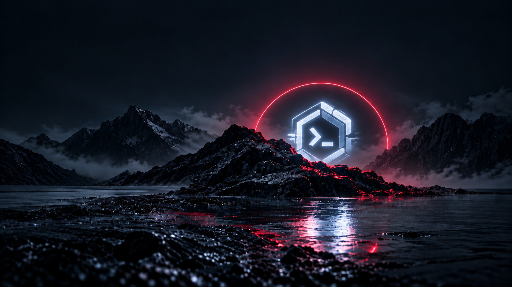

# realhax-desktop



One script that turns a Linux machine into the **realhax Linux** desktop: dark XFCE, neon red ring wallpaper, top panel, bottom dock, conky "System" / "Lab Info" widgets, alacritty + fish, and a fastfetch card.

## One-shot install

```bash
curl -fsSL https://raw.githubusercontent.com/R3dy/realhax-desktop/main/install.sh | bash
```

Run it as your normal user. It asks for your sudo password once, to install packages. When it finishes, log out, pick **Xfce Session** on the login screen, and log in.

Options go after `bash -s --`:

```bash
curl -fsSL https://raw.githubusercontent.com/R3dy/realhax-desktop/main/install.sh | bash -s -- --no-apps
```

| Option | Effect |
|---|---|
| `--no-apps` | skip VS Code and Wireshark (VS Code needs Microsoft's package repository) |
| `--keep-session` | don't make XFCE the default login session |
| `--skip-packages` | user-level config only, no sudo |
| `--no-wallpaper-text` | use the plain wallpaper, without the overlaid slogans |
| `--lab-persona` | the fastfetch card shows `student@realhax` / `Training VM` instead of your real user and host |
| `--restore` | put back every file the installer replaced |

To read the script before running it:

```bash
git clone https://github.com/R3dy/realhax-desktop && cd realhax-desktop
less install.sh && bash install.sh
```

Primary target: Ubuntu 24.04. The script also has package maps for Debian/Ubuntu derivatives (apt), Fedora (dnf), Arch (pacman) and openSUSE (zypper).

## What it does

| Step | Result |
|---|---|
| Packages (apt / dnf / pacman / zypper) | XFCE 4.18, whiskermenu, conky (Lua/Cairo), Papirus, Inter, alacritty, fish, rsvg, sassc (+ VS Code and Wireshark). Packages a distro doesn't have are skipped with a warning. On apt it uses `--no-install-recommends`, so your display manager stays as it is. |
| Fonts | JetBrainsMono Nerd Font v3.4.0 (sha256-pinned) if missing |
| fastfetch | pinned 2.40.4 static build if missing; `neofetch` maps to it |
| GTK + xfwm4 theme | Orchis `2025-04-25` (sha256-pinned), red, black tweak, installed as **RealHax-Dark**. Title bar: dark, app icon at the left, thin minimise/maximise glyphs, red close X |
| Panel CSS | a delimited `realhax` block appended to `~/.config/gtk-3.0/gtk.css` (your own rules are kept; re-runs replace only that block). It only targets panel widgets: the large hex logo and red underline on the menu button, white panel icons |
| Icons | **RealHax** theme: inherits Papirus-Dark, adds red folders, red home, realhax logo, terminal icon |
| Wallpaper | `assets/wallpaper.png` (sha256-pinned) with the mockup's text (OFFENSIVE SECURITY TRAINING, LABS / SKILLS / PRACTICE / PROGRESS, REAL SKILLS. …) overlaid at install time: an SVG with the image plus JetBrains Mono text, rendered by `rsvg-convert` to 2560x1440. Set on every monitor. The plain image is kept as `~/.local/share/realhax/wallpaper-raw.png` |
| Panel | top bar: logo + "Applications" menu; on the right display settings, notifications, volume, tray (network), `Mon Oct 26  21:39` clock, power |
| Desktop | Home, Terminal, Tools, Recon, Reports, Trash, in that order in one column at any resolution (positions written to xfdesktop's `icons.screen*.rc`) |
| Dock | a second, rounded xfce4-panel floating 20px above the bottom edge: Terminal (highlighted), Files, Firefox, VS Code, Editor, Wireshark, a shield slot (KeePassXC / Burp / ZAP if installed), app grid |
| Widgets | one conky Lua/Cairo widget drawing two rounded cards: System (CPU, memory, disk, network graphs) and Lab Info (Attacker turns green when `tun0` is up, IP, OS, uptime, and a clickable **Open Lab Guide** button that opens `$REALHAX_LAB_GUIDE_URL`, default https://realhax.io) |
| Terminal | alacritty RealHax palette; prompt `user@host ~` with a blue path tag and a `❯` line (fish function, or starship via `STARSHIP_CONFIG` inside alacritty) |

## Determinism

- Every download is pinned to a version and checked against a sha256. A mismatch aborts the install.
- XFCE settings are written straight to the xfconf XML files, so the first login always looks the same.
- At each XFCE login, `realhax-session-init` points the wallpaper at whatever monitor names that machine has.
- Desktop icon order: xfdesktop 4.18 stores positions per work-area size and falls back to `icons.screen.latest.rc` for a size it hasn't seen. The installer writes the order there and over any per-size file already saved.
- Re-running is safe. Originals are backed up once, the first time a file is replaced, under `~/.local/share/realhax/backup`, and listed in `manifest.txt`.

## Rebuilding

`install.sh` is generated. Edit `tools/install.sh.in`, then run `tools/build.sh`. If you replace `assets/wallpaper.png`, update `WALLPAPER_SHA256` to match.

`tools/preview.sh OUT.png [:DISPLAY] [WxH] [WAIT]` applies the installer to a throwaway HOME, starts XFCE on Xvfb and takes a screenshot.

## Known gaps vs. the mockup

- The dock's terminal highlight is fixed; it doesn't follow the active window.
- The fastfetch logo is truecolor block art, so it's blockier than the mockup's smooth render.
- The "M" shield app in the mock dock isn't a real app; the slot uses KeePassXC, Burp or ZAP if one is installed.
- The network icon comes from your tray applet (nm-applet), so its look depends on the applet.
- The title-bar icon is the app's own icon (Alacritty's logo, not the mock's `>_`).
